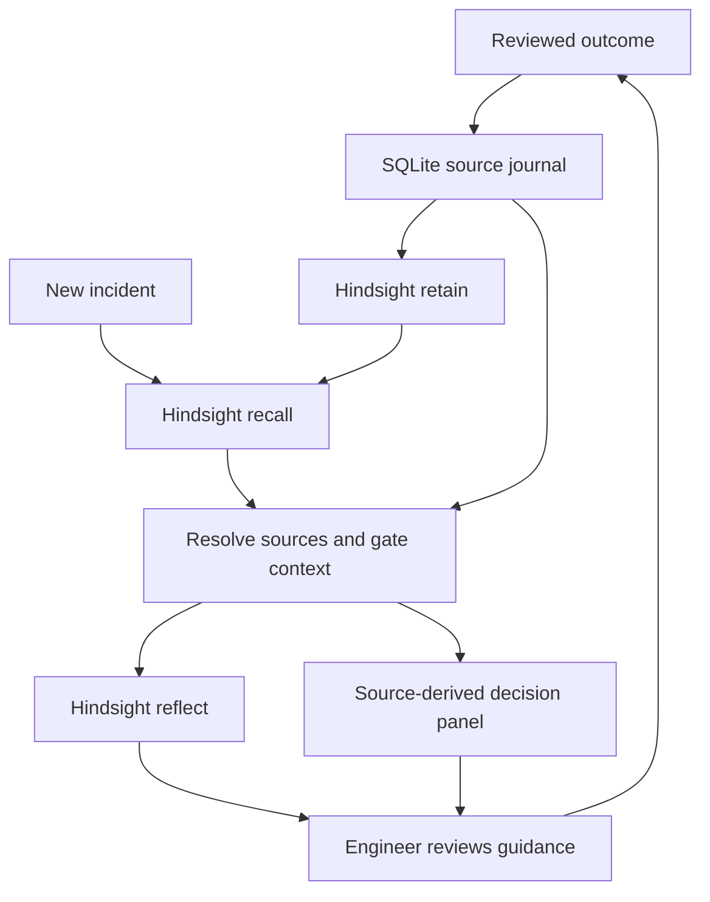

# AfterAction

**An incident-response memory agent that remembers failed fixes and the conditions under which previous fixes worked.**

A payment API is timing out. A generic assistant starts an investigation from scratch. AfterAction recalls earlier attempts, flags a restart that previously worsened connection pressure, surfaces a successful alternative, and withholds both when the architecture changes.

Built for the Engineering & DevOps / Incident Response challenge in the supplied HackwithHyderabad 3.0 brief. See [the project plan](PROJECT_PLAN.md) for judging alignment and the build rationale.

## Run in two minutes — no keys required

Requires **Python 3.11 or newer**. No pip packages, Node installation, or frontend build is needed.

1. Extract the ZIP and open a terminal **inside the `AfterAction` folder** (the folder containing `run.py`).
2. Start the application:

Windows PowerShell:
```powershell
py -3 run.py
```
Ubuntu / macOS:
```bash
python3 run.py
```
3. Open **http://127.0.0.1:8000**.
4. Click **Compare without / with memory**. With an empty database, there is no applicable history.
5. Click **Load 3 sample outcomes**, then compare again. Review the failed action, candidate action, and source records.
6. Change architecture to `pgbouncer` and compare: the old fixes are withheld.
7. Use **Record outcome** to teach the agent a new reviewed result. The next investigation uses it.

`start.bat` and `start.sh` are convenience launchers. Stop with Ctrl+C. Data persists in `data/afteraction.db`. No database is preloaded in the ZIP.

**The default REHEARSAL mode is deterministic local retrieval, not an AI model and not Hindsight. It exists to explore the UI and test the workflow. It does not satisfy the event's mandatory Hindsight requirement.**

## Enable real AI memory with Hindsight

You need a Hindsight Cloud account, a dedicated memory bank, and an API key. The app uses Hindsight's own model-backed `retain` and `reflect` operations, so a separate Groq or OpenAI key is **not required for Hindsight Cloud**. Self-hosted Hindsight requires its own model configuration and credentials; follow its official installation guide.

1. Register at https://ui.hindsight.vectorize.io and create a dedicated bank. Copy its **bank ID**, which may differ from its display name.
2. Create a key with access to that bank. Check account credits/billing.
3. Copy `.env.example` to `.env` in the project root:

Windows:
```powershell
Copy-Item .env.example .env
notepad .env
```
Ubuntu / macOS:
```bash
cp .env.example .env
nano .env
```
4. Set:
```dotenv
MEMORY_MODE=hindsight
HINDSIGHT_BASE_URL=https://api.hindsight.vectorize.io
HINDSIGHT_API_KEY=YOUR_ACTUAL_KEY
HINDSIGHT_BANK_ID=YOUR_ACTUAL_BANK_ID
HINDSIGHT_TIMEOUT=45
```
5. Restart `run.py`. Confirm **HINDSIGHT LIVE** in the page header. This indicates configured mode, not verified connectivity.
6. Click **Retry Hindsight sync** if you already used rehearsal, or **Load 3 sample outcomes** if starting fresh. Look for `retain / ok` in Memory activity. The ledger must show synced records.
7. Compare the incident. Confirm `recall / ok` and `reflect / ok`, inspect raw recalled facts, and verify the source IDs. Indexing can take time; retry the comparison after processing completes.

The bank must already exist. The app deliberately does not create or delete banks. The supplied brief mentions a `MEMHACK99` credit code; its current validity has not been verified, so do not depend on it.

### Live acceptance check

After configuring a **dedicated demo bank**, run:
```bash
python live_check.py
```
On Windows use `py -3 live_check.py`. This **writes the three fictional sample episodes** into your configured bank and local database, recalls the sample case and checks for a candidate fix and failed-action warning. It exits nonzero on failure. It is not an offline test or a simulated success. It can incur Hindsight usage charges.

**Delivery verification:** offline tests and fake-server HTTP integration tests were run successfully. Real Hindsight Cloud calls could not be verified here because no credentials were supplied. Run this acceptance check and inspect the UI before recording or submitting. The application never silently falls back from Hindsight to local retrieval.

## What is implemented

- Persistent source ledger of human-reviewed outcomes with stable `AA-...` IDs.
- Hindsight HTTP retain, recall and reflect integration with strict service/environment filters.
- Evidence resolution from returned metadata, document/context IDs, or original source chunks.
- Architecture and retirement gates before previous actions enter the guidance panel.
- Failed attempts, useful attempts, inconclusive attempts and contradictory outcomes shown separately.
- Hindsight reflection constrained to eligible lesson tags, with generated prose visually separated from source-derived decisions.
- Before/after comparison against a transparent generic checklist (not another LLM benchmark).
- Outcome feedback form, sync retry for failed writes, trace panel, JSON export, responsive UI.
- Basic credential redaction before local persistence and external retention.
- A no-key rehearsal backend for local exploration; its output is explicitly labeled.

## How memory is central



SQLite is the source journal and retry state, not a hidden semantic-memory replacement in live mode. If Hindsight does not return a resolvable source episode, that local row cannot become a recommendation. Reflection is skipped if no eligible evidence exists.

“Learning” means accumulating reviewed outcomes and changing future guidance. It does not mean model fine-tuning. A single reported success is a candidate for investigation, not proof of causation.

## Tests

From the project root:
```bash
python -m unittest discover -s tests -v
```
Use `py -3` on Windows if `python` is unavailable. Tests use temporary databases and a localhost fake Hindsight server; no API keys or billable calls. See [verification notes](docs/VERIFICATION.md) for actual checks and limitations.

## Docker option

Create `.env` first, then:
```bash
docker compose up --build -d
docker compose logs -f
```
Open http://127.0.0.1:8000. Compose binds only to your local machine and persists `./data`. The first build needs Docker Hub access. Stop with `docker compose down` (the bind-mounted data remains).

The Docker configuration is supplied but was not executed in the build environment. The directly executed Python application was tested.

## Files

| File | Purpose |
|---|---|
| `PROJECT_PLAN.md` | Project choice, judging alignment, scope, and demo strategy |
| `afteraction/memory.py` | Real Hindsight adapter and clearly labeled rehearsal adapter |
| `afteraction/domain.py` | Validation, redaction and applicability/conflict policy |
| `afteraction/store.py` | SQLite journal and operation trace |
| `afteraction/service.py` | Investigation → feedback → retention workflow |
| `afteraction/server.py` | Local HTTP server and API |
| `afteraction/static/` | Complete browser interface |
| `tests/test_agent.py` | Domain, persistence, HTTP and integration tests |
| `live_check.py` | Credentialed acceptance check, explicitly writes demo outcomes |
| `docs/DEMO_SCRIPT.md` | Screen-recording walkthrough |
| `docs/SUBMISSION_CHECKLIST.md` | Required deliverables and remaining work |
| `docs/article.md` | Technical article draft, review before publishing |
| `docs/social-post.md` | Social post draft with repository placeholder |
| `docs/ARCHITECTURE.md` | APIs, threat boundaries, limitations |

## What you must provide or complete

1. **Hindsight account, bank, key and credits.** Set `.env`, verify the live flow, and keep the key private.
2. **A public GitHub repository.** Push this folder after checking `.env` and `data/*.db` are ignored. Fill your team name and repository links in the submission materials. This folder has not been uploaded or published for you.
3. **Live demo availability.** Run the local app for judges. If remote access is required, add authenticated hosting and an appropriate production server. The included server intentionally accepts only localhost hostnames and is not ready for public hosting.
4. **Video.** Record the real live-mode walkthrough at 1080p, 2–5 minutes, then upload a public YouTube video. No video was fabricated or published.
5. **Content.** Each member should review and personalize their own article and social post, publish them, add actual links, and follow the guide's tagging/link requirements. One article draft is included; do not submit identical first-person accounts for multiple people.
6. **Submission form.** Supply the actual team, member and contact details, public URLs, and any organizer-specific eligibility declarations. The documents do not establish a submission deadline or guarantee selection.

## Known limits and operating boundaries

- Single operator, one configured bank. No authentication, multi-tenant permissions, encryption at rest, or production audit system.
- No automatic command execution, integrations with Kubernetes/Slack/Jira, or ingestion of arbitrary files.
- Architecture is a human-supplied compatibility label. Exact matches are conservative, but not a substitute for complete environment/version constraints or temporal reasoning.
- Contradiction grouping normalizes casing and whitespace in the action name; semantically equivalent actions with different wording may not be grouped.
- Retire is local suppression, **not remote deletion**. Use Hindsight's management tools for deletion requirements. Do not claim “right to be forgotten” support.
- Basic regex redaction is incomplete. Review and sanitize input; never use real secrets or customer logs in the demo. Live mode sends reviewed text and incident queries to Hindsight.
- Reflection is generated text and can be wrong or influenced by malicious content. Prompt boundaries and source gates reduce some risks but do not provide a complete prompt-injection defense. The tool cannot execute actions.
- The generic baseline is deliberately transparent. No claim of model-quality improvement, reduced MTTR, predictive accuracy or production performance is made.
- Rehearsal retrieves at most 30 overlapping episodes, live recall is token-budgeted, and both can miss evidence. Absence of a recalled failure does not mean an action is safe.
- Failed synchronous retention remains pending; retry uses a stable document ID. A lost response may require a retry even when remote processing completed. Provider behavior remains authoritative.
- Export includes locally stored incident text. Store exports carefully. No import feature is implemented.

## Troubleshooting

| Symptom | What to do |
|---|---|
| `401` / `403` from Hindsight | Check key, access and bank ID; restart after editing `.env` |
| `404` | Create the bank first and use its ID; confirm the base URL has no `/v1` suffix |
| `422` | Check server API compatibility with the linked documentation; inspect the adapter fields |
| `429` / credits exhausted | Check provider usage limits and wait before retrying |
| Retain timeout | Keep the local record; wait for remote processing, then Retry sync. Increase timeout if necessary |
| No source episodes after successful recall | Inspect raw facts; verify source context/chunks, current bank and sync status; retry after indexing |
| Reflection fails | Source-derived guidance remains visible; check provider configuration and retry |
| Port 8000 occupied | Set `PORT=8001` in `.env`, restart, open `http://127.0.0.1:8001` |
| Localhost-only error | Use exactly `127.0.0.1` or `localhost`, with the configured port. Public hosting needs a separate hardening pass |
| Want a fresh walkthrough | Stop app, back up `data/afteraction.db`, move it aside; use a new dedicated Hindsight bank for a truly fresh live demonstration |

Official integration references checked during development: [Hindsight API](https://hindsight.vectorize.io/api-reference), [Cloud quick start](https://docs.hindsight.vectorize.io/getting-started/), [source repository](https://github.com/vectorize-io/hindsight). See the supplied event documents for authoritative submission requirements.
